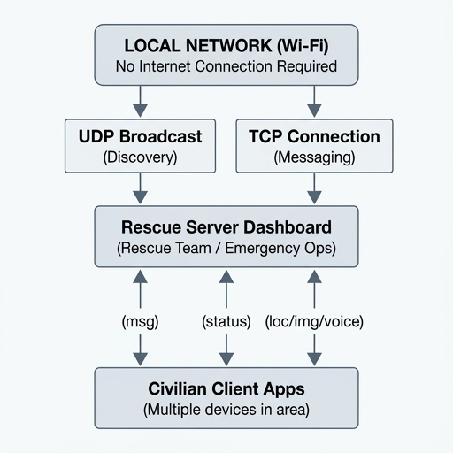

# Disaster Communication (RescueLink)

## Overview

Disaster Communication is an offline-first emergency communication system designed for use during earthquakes and other natural disasters in high-seismic activity zones. Built to function **without internet access**, this application enables direct communication between rescue teams and civilians through a local area network (LAN), allowing users to share their location, status, images, and voice messages when traditional communication infrastructure is compromised.

The system consists of a **Rescue Server (Dashboard)** for emergency responders and a **Civilian Client** for those seeking assistance. Both applications operate on the same local Wi-Fi network, automatically discovering each other via UDP broadcast - no manual IP configuration required.

## Key Features

- **Offline-First Operation**: Designed for deployment in disaster scenarios where cellular, internet, and cloud services may be unavailable
- **Automatic Server Discovery**: Civilians are automatically detected by the server via UDP broadcast on the local network
- **Location Sharing**: Civilians can send their location descriptions to rescuers for rapid identification and assistance
- **Status Reporting**: Quick status selection (OK, injured, cannot move, need help, medical emergency) with optional details
- **Image Transmission**: Send photos to provide visual context of damage, injuries, or surroundings
- **Voice Messaging**: Record and transmit short voice messages when typing is difficult
- **Real-Time Communication**: Bidirectional messaging between rescuers and civilians
- **Cross-Platform Ready**: Built with Python and Tkinter for broad compatibility
- **Portable Executables**: Standalone .exe builds available for Windows deployment

## Target Use Case

**Earthquake Response in High-Risk Zones**: This application is built to run on rescue team devices (laptops/tablets) and is designed for deployment on mobile phones (APK/Android builds or cross-platform mobile ports). It is **ready to be deployed** in earthquake-affected areas with high seismic activity, particularly where internet and cellular infrastructure have been compromised. When deployed on a local Wi-Fi network (mobile hotspots, portable routers, or device-to-device networks), it creates an offline communication channel enabling rescuers and civilians to connect, share locations, and coordinate life-saving efforts without internet access.

## System Architecture

 

*This is part of the whole assembly project: an autonomous driven drone and an antenna to track phone signals.*

## Drone & Antenna Subsystems

This disaster communication platform is integrated as a critical component within a larger emergency response system consisting of:

- **Autonomous Drone System**: An unmanned aerial vehicle (UAV) designed for autonomous navigation in disaster-stricken areas to support search and rescue operations. The drone provides aerial reconnaissance and can serve as a mobile relay point to extend local network coverage in hard-to-reach or obstructed zones.
- **Antenna Tracking System**: A custom-built directional antenna system engineered to track and locate phone signals in areas with compromised infrastructure. This subsystem works in conjunction with the communication platform to help pinpoint the locations of civilians in need of assistance.

These subsystems work together with the disaster communication app to enhance situational awareness and improve the speed and precision of rescue operations in high earthquake-risk zones.

## Components

### 1. Rescue Server (server_app.py)
- **Purpose**: Command center dashboard for rescue personnel
- **Features**:
  - Real-time monitoring of connected civilians
  - Message feed displaying all incoming reports (location, status, images, answers)
  - Send direct replies and structured questions to individuals
  - Auto-discovery broadcast to allow civilians to find the server
  - Image reception and local storage in 
eceived_images/
  - Connection management with online/offline tracking

### 2. Civilian Client (Civilians.py)
- **Purpose**: Emergency communication interface for civilians
- **Features**:
  - Automatic network detection and server discovery
  - Submit emergency status with severity levels
  - Send precise location descriptions
  - Attach and transmit images
  - Record and send voice messages (requires sounddevice + 
umpy)
  - Receive replies and questions from rescue teams
  - Modern, user-friendly interface for high-stress situations

## Installation & Setup

### Prerequisites

- Python 3.8 or higher
- Tkinter (included with standard Python installations)
- For voice messaging: sounddevice and 
umpy

### Install Dependencies

`ash
pip install sounddevice numpy
`

### Running the Server (Rescue Team)

1. Connect the rescue device to a local Wi-Fi network (hotspot/router)
2. Run the server dashboard:
   `ash
   python server_app.py
   `
3. The server will display its LAN IP address and begin broadcasting for automatic discovery
4. Keep this application open throughout the operation

### Running the Civilian Client

1. Connect the civilian device to the same local Wi-Fi network
2. Run the client application:
   `ash
   python Civilians.py
   `
3. Enter your name and connect - the app will automatically discover the rescue server
4. Use the interface to send location, status, images, or voice messages

## Building Standalone Executables

### Using PyInstaller

Build the Rescue Server:
`ash
pyinstaller --onefile --windowed --name RescueServer server_app.py
`

Build the Civilian Client:
`ash
pyinstaller --onefile --windowed --name RescueLink Civilians.py
`

Pre-built executables are available in the dist/ directory.

## Network Configuration

- **Broadcast Port**: 50005 (UDP) - for server discovery
- **Server Port**: 5006 (TCP) - for message communication
- **Protocol**: JSON-encoded messages over TCP with 4-byte length prefix
- **Works on**: Local networks (192.168.x.x, 10.x.x.x, 172.16-31.x.x)

## Deployment Recommendations for Earthquake Events

1. **Pre-Deployment**: Install the server app on rescue team laptops and pre-configure portable Wi-Fi hotspots
2. **On-Site**: Set up a local hotspot/router in the affected area to create an island network
3. **Distribution**: Provide civilian clients via USB drives, local file sharing, or pre-installed on emergency devices
4. **Operation**: Server broadcasts presence; civilians connect automatically without needing internet or external DNS
5. **Data Handling**: Received images and logs are stored locally on the server device for post-rescue documentation

## Security & Privacy

- **Local-Only**: All communications remain on the local network; no data leaves to external servers
- **No Authentication Required**: Simplified for emergency use - rescue teams verify identities in-person as needed
- **Ephemeral Data**: Designed for immediate rescue coordination; implement your own data retention policies per operational requirements

## Contributing

Contributions are welcome to improve disaster response capabilities. Please submit pull requests with clear descriptions of changes.

## License

This project is available under the MIT License. See the [LICENSE](LICENSE) file for details.

## Acknowledgments

Developed as an Electrical & Computer Engineering project to address critical communication needs in disaster scenarios. Special focus on usability under high-stress emergency conditions and reliability in infrastructure-compromised environments.

---

**Disclaimer**: This is an emergency communication tool to supplement - not replace - official emergency services. Always follow local emergency protocols and contact official rescue services when possible.
